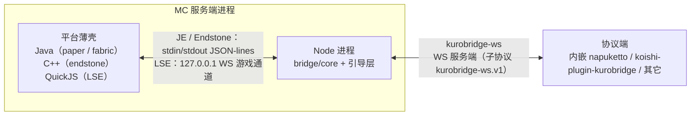

# 架构总览

## 1. 定位

KuroBridge 是 Minecraft 服务器的群服互通插件：游戏事件（聊天 / 进服 / 退服 / 死亡 / 状态）发往社交平台群，群消息与群指令回到游戏。

三条硬边界决定了整体形状：

- **kurobridge 永远是 WebSocket 服务端**：协议端主动连入，kurobridge 不反向连接。
- **业务核心在 Node**：绑定、管理员、转发、配置热载都在 TypeScript 的 `bridge/core`；平台薄壳只做事件/命令/权限/进程管理。
- **只认一套自研协议 `kurobridge-ws`**：对端可以是内嵌 napuketto、独立 napuketto、koishi-plugin-kurobridge 或任何其它实现。

## 2. 运行拓扑



| 宿主 | 薄壳语言 | 薄壳 ↔ Node | 产物 |
| --- | --- | --- | --- |
| Paper | Java 21 字节码（工具链 25） | stdin/stdout JSON-lines | `kurobridge-0.1.0.jar`（shadowJar） |
| Fabric | Java 21 字节码 | stdin/stdout JSON-lines | `kurobridge-fabric-0.1.0.jar`（loom remapJar） |
| Endstone | C++20 | stdin/stdout JSON-lines | `endstone_kurobridge.dll` |
| LeviLamina / LSE | TypeScript → QuickJS | 127.0.0.1 回环 WS（平台无 stdio 子进程 API） | `index.js` + `bin/index.mjs` |

## 3. 两种对端形态

没有顶层 `mode` 开关。差异只在配置与协议端是否随包，**业务核心完全相同**。

|  | embedded | external |
| --- | --- | --- |
| 协议端 | JAR 内含 napuketto CLI，由 Node 拉起为子进程 | 外部进程（koishi-plugin-kurobridge 等）主动连入 |
| 开启方式 | `embedded.napuketto.enabled: true` + 固定 `ws.port` | 不写 `embedded` 段 |
| 端口 | **必须固定**（napuketto 的 TOML `url` 是静态的） | 可固定；缺省 `listen(0)` 动态端口 |
| 平台 | 仅 Windows 启用 QQ 宿主；非 Windows 记 error 后继续做纯 WS 服务端 | 全平台 |
| 开箱即用 | 是（控制台扫码登录） | 需另部署协议端 |

JE（paper / fabric）支持两种形态。LSE 与 Endstone 当前交付只支持 external 形态的对端；Endstone 的 Node 进程仍是内嵌运行时，但不随包 napuketto。

## 4. 模块与依赖方向

```
@kuro-bridge/protocol（npm ^0.4.0，姊妹仓 KuroProtocol 发布）
    zod schema + 帧工厂 + 版本常量 + 金样本；零框架依赖
        ▲
        │
bridge/core（@kuro-bridge/bridge-core）
    业务核心 + WS 服务端；零 Node API、零框架、target ES2020
        ▲                              ▲
        │                              │
bridge/embedded                 platforms/be/lse（workspace 依赖）
    Node 引导层：ws / stdin-stdout      QuickJS 壳 + Node shim
    / fs / napuketto 进程              （shim 宿主 core）
        │
        ├── esbuild 单文件 → platforms/je/{paper,fabric} 的 embedded 资源
        └── 同产物手动预置 → platforms/be/endstone 的 bin/

platforms/je（Gradle 多模块）
    :core    IPC 编解码 + 进程/看护 + JAR 运行时解压（零 Bukkit API）
    :paper   Paper 适配
    :fabric  Fabric mod 适配
    :neoforge / :velocity   预留骨架

platforms/be/endstone（CMake 双层）
    src/core/   portable 层：JSON / 帧编解码 / Win32 进程 / IPC / 看护
    src/        endstone 面：插件入口 / 事件 / 请求处理
```

**依赖红线**：

- `bridge/core` 禁止任何 Node API（`ws`、`process`、`fs`、`pino` 等），传输层与 logger 全部依赖注入 → QuickJS 可跑。
- 平台薄壳不引协议逻辑；消息类型只从 `@kuro-bridge/protocol` 导入，禁止手写帧类型。
- koishi-plugin-kurobridge 是独立仓库，不在本仓开发；平台渲染（富文本 / 颜色码 / 长度收敛）只属于那里。
- LSE 的「WS 回环游戏通道」是平台 API 限制下的传输替代（ADR-037），不改变「kurobridge 是 WS 服务端」的对外角色。

## 5. 业务归属

| 数据 / 逻辑 | 归属 | 说明 |
| --- | --- | --- |
| 绑定频道、管理员映射、转发规则、配置解析与热载 | `bridge/core` | 业务唯一权威 |
| WS 握手 / 鉴权 / 心跳 / 请求-响应 / 查询 | `bridge/core` | `KurobridgeServer` + `Relay` |
| 游戏事件采集、命令执行、广播、进程拉起与看护 | 平台薄壳 | 零业务，只做 API 桥接 |
| 协议端（QQ / Telegram / Discord 连接与平台渲染） | 独立协议端仓库 | napuketto / koishi-plugin-kurobridge |
| 协议 schema / 版本 / 金样本 | KuroProtocol 仓 | 本仓经 npm 消费，无副本 |

## 6. 仓库结构

```
KuroAdapter/
├── bridge/
│   ├── core/            # @kuro-bridge/bridge-core（平台无关）
│   └── embedded/        # @kuro-bridge/bridge-embedded（Node 引导层）
├── platforms/
│   ├── je/              # Gradle：core / paper / fabric / neoforge / velocity
│   └── be/
│       ├── lse/         # LeviLamina 平台适配（壳 + Node shim）
│       └── endstone/    # Endstone 适配（C++ 薄壳 + portable 层）
├── toolings/
│   ├── build/           # platforms.ts：je | endstone | all
│   ├── gates/           # docs scope / docs links / versions
│   ├── lib/             # 构建脚本共用进程助手
│   ├── packaging/       # embed.ts + build-jar.ts
│   └── paper/           # 沙盒入口 paper.cmd 与假人
├── docs/                # 本目录
├── sandbox/             # 运行产物（gitignore）
└── readme.md / AGENTS.md / package.json / pnpm-workspace.yaml / biome.jsonc / tsconfig.json
```

## 7. 技术栈

| 模块 | 语言 / 运行时 | 关键依赖 | 构建 | 测试 |
| --- | --- | --- | --- | --- |
| `bridge/core` | TS → ESM，target ES2020 | zod、`@kuro-bridge/protocol` | tsdown | vitest |
| `bridge/embedded` | TS → ESM 单文件 | `ws`、`@napuketto/cli`（精确 pin） | esbuild | vitest |
| `platforms/je` | Java 21 字节码（工具链 25） | Paper API / Fabric Loader+API（均 compileOnly 类）、Jackson | Gradle：shadowJar / loom remapJar | JUnit 5 |
| `platforms/be/lse` | TS → QuickJS IIFE + Node ESM shim | `ws`、LSE 官方类型 | esbuild 双产物 | vitest（含回环 e2e） |
| `platforms/be/endstone` | C++20 | Endstone API（header-only）+ expected-lite | CMake presets | ctest（5 目标） |

工程基准：Node 26、pnpm 11.6、TypeScript 7、Java 25（target 21）、Gradle 9.7、CMake ≥ 3.29。Node 运行时分发版本钉 26.7.0（`toolings/packaging/embed.ts`）。

## 8. 红线

1. 平台薄壳不写业务（绑定 / 权限 / 转发）。
2. `bridge/core` 不出现任何 Node API 或框架 API。
3. 消息类型不手写，只 import `@kuro-bridge/protocol`。
4. 不引入 OneBot 11；不复制 HuHoBot / NapCat / NapukettoQQ 代码；全仓 MIT。
5. 腾讯闭源件（`wrapper.node`、QQ 安装包、QQNT 二进制）不进 JAR，构建期扫描断言。
6. JE / Endstone 的薄壳 ↔ Node 只用 stdin/stdout JSON-lines；薄壳不监听对外端口（LSE 的 127.0.0.1 游戏通道是唯一例外，且只绑回环）。
