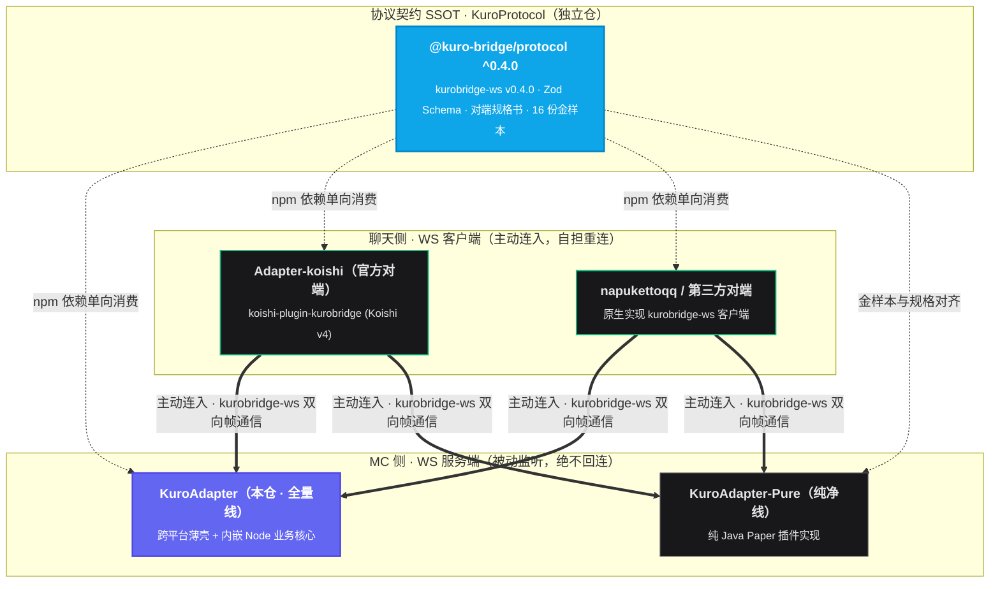
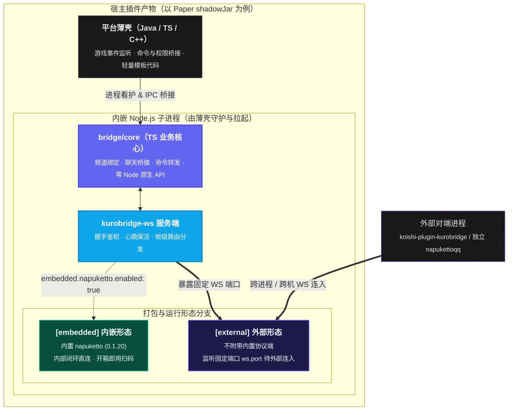

<div align="center">

<br />


**Minecraft 服务器与社交平台群服互通 · 全量线服务端**

<p>
  &emsp;
  &emsp;
  &emsp;
  
</p>

<p>
  <a href="#快速开始">快速开始</a> &nbsp;·&nbsp;
  <a href="#参与贡献">参与开发</a> &nbsp;·&nbsp;
  <a href="#文档导航">文档导航</a> &nbsp;·&nbsp;
  <a href="#english">English</a>
</p>

<br />

</div>

---

## 生态定位

**KuroBridge** 是「Minecraft 服务器 ↔ 聊天平台」双向互通产品线，本仓（`KuroAdapter`）是其**全量线服务端**实现。全生态拓扑与协议消费关系如下：

<details>
<summary><b>点击展开：KuroBridge 全生态拓扑与协议消费关系图</b></summary>



</details>

* **永远作为 WS 服务端**：只认自研协议 `kurobridge-ws`，与对端框架彻底解耦；连接生命周期与断线重连由对端自担。
* **单一事实来源（SSOT）**：帧名称与载荷结构严格以 `KuroProtocol` 的 Zod Schema 为准，**本仓任何位置禁止手写消息类型**。

### 边界与职责（身份卡）

| 本仓负责 (In Scope) | 本仓不负责 (Out of Scope) |
| :--- | :--- |
| **`kurobridge-ws` 服务端**：握手、鉴权、心跳、帧收发与频道级路由分发 | **协议契约定义**：SSOT 位于 [KuroProtocol](https://github.com/Kuro-Bridge/KuroProtocol)，本仓仅经 npm 依赖消费 |
| **平台无关业务核心 (`bridge/core`)**：频道绑定、聊天桥接、命令与状态查询转发 | **官方对端实现**：`Adapter-koishi` 独立成仓维护（详见 ADR-018） |
| **JE / BE 跨平台薄壳**：Paper、Fabric、LSE 已落地；Endstone 待真机联调 | **聊天平台适配**：QQ / Telegram / Discord 等协议对接由对端侧框架承担 |
| **双形态打包分发**：提供 `embedded`（内嵌 `napuketto 0.1.20`）与 `external` 形态 | **宿主运行环境**：MC 服务端本体、Java 运行时及外部机器人实例由用户自备 |

---

## 形态与进程模型

<details>
<summary><b>点击展开：宿主插件与内嵌 Node.js 子进程架构图</b></summary>



</details>

### 双形态对照（架构同源，仅打包与启用策略不同）

| 维度 | `embedded`（内嵌开箱形态） | `external`（外部接入形态） |
| :--- | :--- | :--- |
| **适用场景** | 单机服主快速部署，无需额外部署机器人框架 | 已有独立 Koishi / NapukettoQQ 实例，或需跨机解耦部署 |
| **内置组件** | 打包内嵌 `napuketto (0.1.20)`，开箱即可扫码登录 | 纯净服务端，不附带任何聊天平台协议端 |
| **核心配置条件** | 显式开启 `embedded.napuketto.enabled: true`（默认关闭） | 必须在 `ws.port` 中指定固定监听端口供外部连入 |
| **底层业务核心** | 运行同一套 `bridge/core` + `kurobridge-ws` | 运行同一套 `bridge/core` + `kurobridge-ws` |

* **单一配置源**：统一读取 `plugins/kurobridge/config.json`（缺失时自动生成默认模板）。
  * **热重载生效**：`channels` / `admins` 保存即热效（`embedded` 模式 2s 轮询，或执行 `/kurobridge reload` 触发；*注：LSE 平台无热载，需重启*）。
  * **冷重启生效**：`token` / `ws` 网络段修改后需重启服务端。完整语义参见 [配置参考](docs/reference/config.md)。

---

## 平台矩阵

| 家族 | 平台 | 状态 | 架构与实现说明 |
| :---: | :--- | :---: | :--- |
| **JE** | **Paper** | **已实现** | **主形态**：`kurobridge-0.1.0.jar`（shadowJar，内嵌 Node 运行时与业务核心） |
| **JE** | **Fabric** | **已实现** | 首版 Mod 薄壳（五事件对齐 Paper，chat / status 存在微小注册差异） |
| **JE** | NeoForge | `预留` | 模块工程骨架已就位（ADR-021） |
| **JE** | Velocity | `预留` | 模块工程骨架已就位（ADR-021） |
| **BE** | **LeviLamina / LSE** | **已实现** | TS 薄壳（R2′ WS 回环），不支持热重载，修改配置需重启 |
| **BE** | **Endstone** | *已构建* | `portable` 层与 `clang-cl` DLL 编译全绿，真机联调待排期 |

---

## 快速开始

### 1. 构建产物

```bash
pnpm install
pnpm build:jar    # 流水线：TS 构建 → 资源内嵌 → shadowJar → Fabric remapJar
```

构建完成后，提取 `platforms/je/paper/build/libs/kurobridge-0.1.0.jar` 放入 Paper 服务器的 `plugins/` 目录。

### 2. 最小化配置

首次启动会在 `plugins/kurobridge/config.json` 生成默认配置（`external` 形态下必须固定 `port`）：

```json
{
  "channels": ["123456789"],
  "token": "change-me",
  "ws": {
    "host": "127.0.0.1",
    "port": 25580
  }
}
```

* `channels`：WS 协议端绑定的目标频道列表（自动去重保序）。游戏事件按此列表广播（Fan-out），聊天平台消息仅在命中列表时转发入服。
* `ws.port`：建议避开 `25565`（MC 主端口）与 `25575`（RCON 端口）。

> [!IMPORTANT]
> **安全与鉴权提示**：若 `token` 留空则视为不启用鉴权（配置了 `ws` 段时控制台会输出 `WARN`）。由于底层采用明文 WebSocket，**跨公网部署时请务必通过隧道或反向代理完成 TLS 终结**。

### 3. 连入聊天对端

* **Koishi**：安装官方插件 [`koishi-plugin-kurobridge`](https://www.npmjs.com/package/koishi-plugin-kurobridge)，将 `url` 设为 `ws://<主机>:<端口>`，`token` 与服务端保持一致。
* 再在Koishi上安装任意适配器，即可通过这些适配器向相关群聊群服互通
* **联调验证**：对端日志打印握手成功及频道绑定快照后，即可测试「群聊消息进服」与「游戏内发言回群」。对端握手、关闭码及帧语义的完整规范请查阅 [Peer Guide](https://github.com/Kuro-Bridge/KuroProtocol/blob/main/docs/peer-guide.md)。

---

## 参与开发

```bash
pnpm check        # 首环构建 + Biome 检查 + tsc + LSE 类型检查 + 文档门禁 + 版本号对齐
pnpm test         # 运行 Vitest 测试套件（基线：247 用例 / 23 文件，详见 docs/status.md）
pnpm check:all    # 本地全量模拟 CI 三项 Job 合体检查
pnpm build:all    # 编译打包全平台产物
```

* **技术栈规格**：
  * **TypeScript**：TS 7（Biome 格式化与检查 + 严格 `tsconfig` 全家桶）。
  * **Java 宿主**：Toolchain 25 / 字节码 Target 21，开启 `-Xlint:all -Werror` + Spotless 规范（ADR-015），构建系统采用 Gradle 9.7。
* **架构红线与依赖方向**：
  * `bridge/core` 保持纯粹：**零 Node.js 原生 API、零外部重型框架**（确保可平替运行于 QuickJS 环境）。
  * 平台薄壳仅做桥接，严禁染指协议解析；协议 SSOT 仅允许通过 npm 依赖单向消费（ADR-031 / ADR-035）。
* **工程台账**：研发规约与依赖白名单见 [AGENTS.md](AGENTS.md)；架构决策记录（ADR-001 ~ 037）见 [docs/decisions.md](docs/decisions.md)；当前里程碑与技术债见 [docs/status.md](docs/status.md)。

---

## 文档导航

| 核心主题 | 推荐阅读入口 |
| :--- | :--- |
| **定位、拓扑、模块边界与架构红线** | [架构总览 (Architecture Overview)](docs/architecture/overview.md) |
| **启动、握手、转发、热载、进程看护与关停** | [运行时机制 (Runtime)](docs/architecture/runtime.md) |
| **Core / Embedded / JE / LSE / Endstone 细节** | [模块拆解文档 (Modules)](docs/modules/bridge-core.md) |
| **配置文件全字段语义说明** | [配置参考手册 (Config Reference)](docs/reference/config.md) |
| **协议包消费与校验方式** | [协议接入参考 (Protocol Reference)](docs/reference/protocol.md) |
| **本地开发流与全平台构建发布** | [开发指南](docs/guides/development.md) · [构建与发布](docs/guides/build.md) |
| **全仓文档总索引** | [文档中心 (Docs Index)](docs/README.md) |

---

## English

**KuroBridge** (repository name `KuroAdapter`) is the **full-line server** implementation of a bidirectional Minecraft ↔ Chat-Platform bridge. Distributed primarily as a Paper JAR, its lightweight Java thin shell supervises an embedded Node.js subprocess that powers the TypeScript business core and the `kurobridge-ws` WebSocket server.

External chat peers — such as the official Koishi adapter (`koishi-plugin-kurobridge`), `napukettoQQ`, or custom third-party implementations — actively connect to KuroBridge as WebSocket clients. All protocol contracts and schemas live in the sibling repository [KuroProtocol](https://github.com/Kuro-Bridge/KuroProtocol) (SSOT) and are consumed strictly via the `@kuro-bridge/protocol` npm package; handwritten message types are strictly forbidden in this codebase.

```bash
pnpm install && pnpm build:jar
```

*Entirely original implementation, released under the [MIT License](./LICENSE).*
